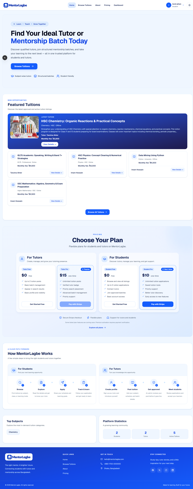
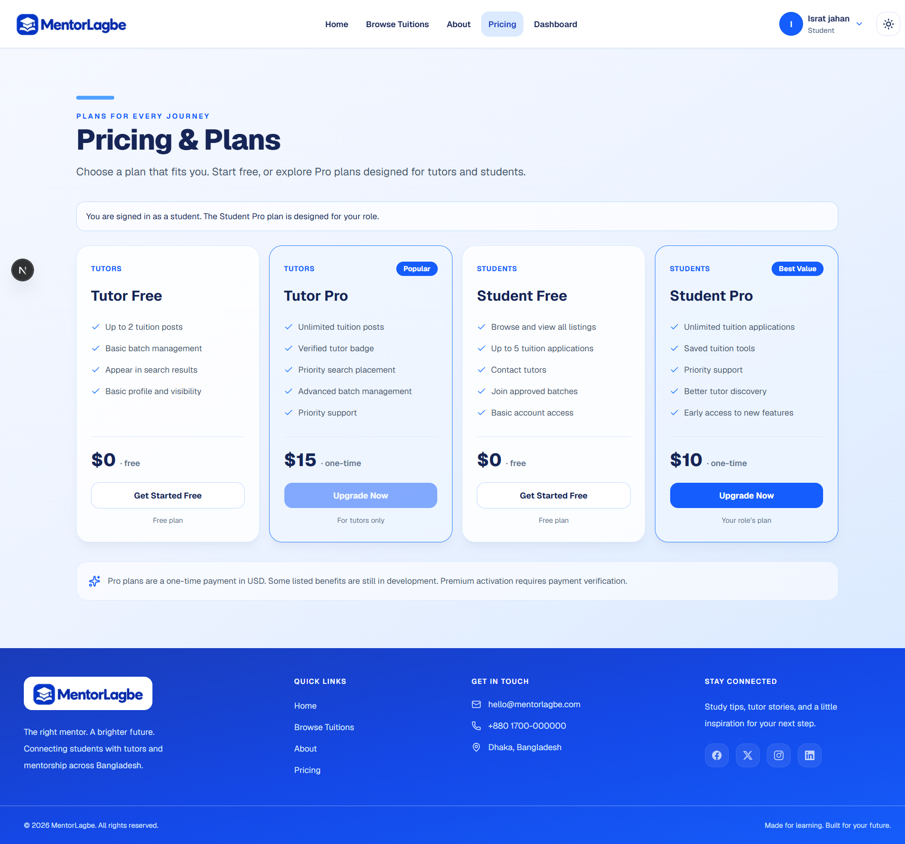
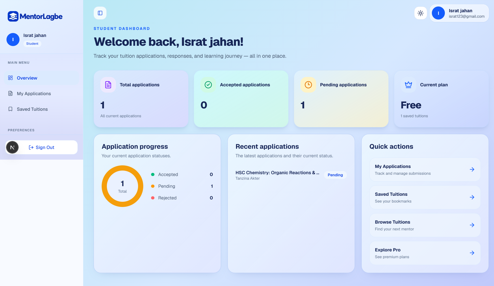
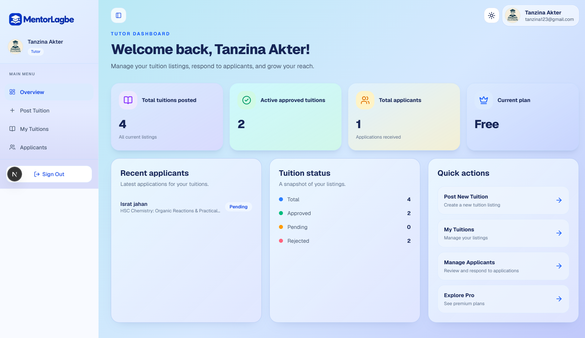
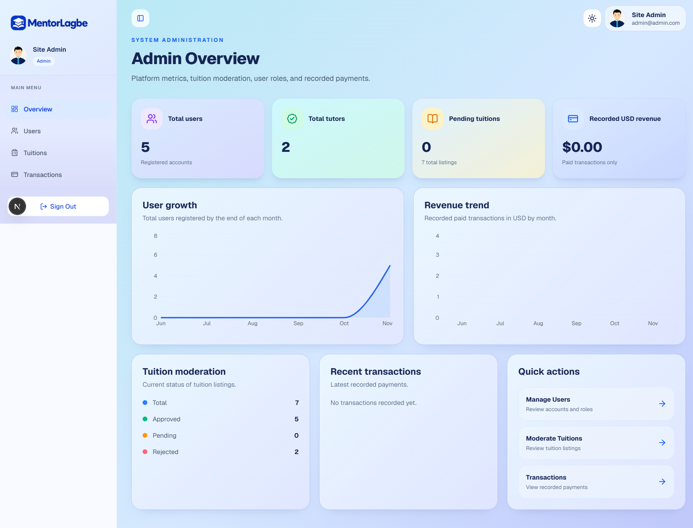
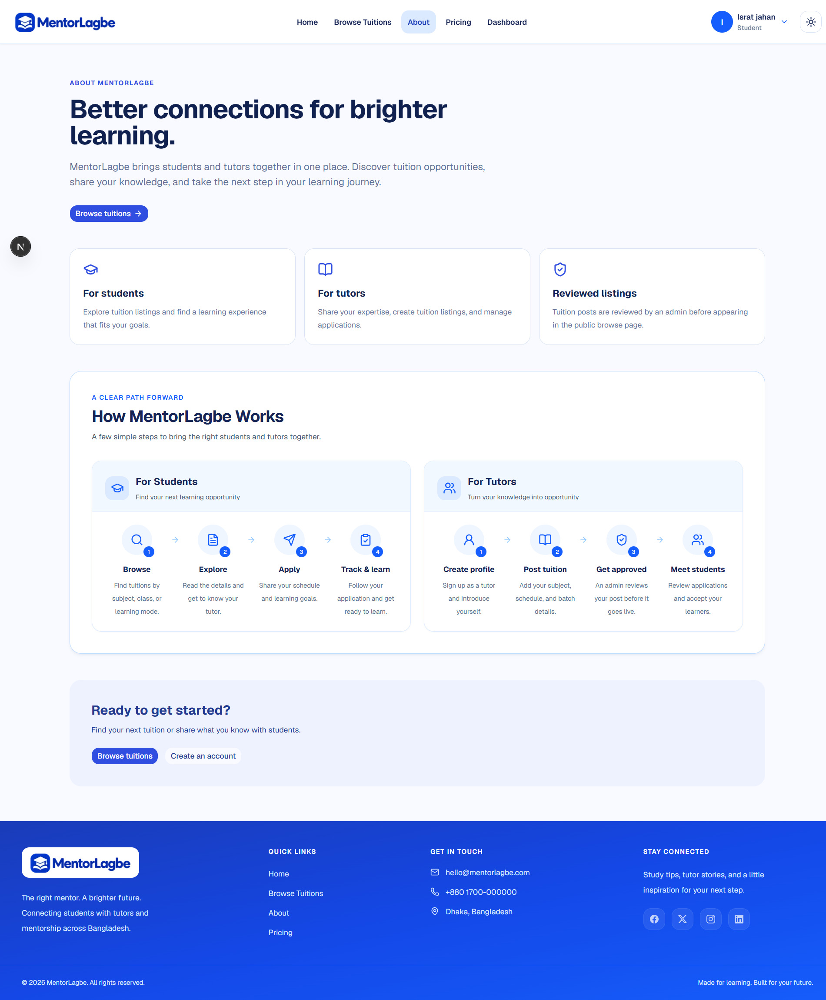

# 🎓 MentorLagbe — Find Your Mentor

**Connecting students with the right tutors and learning opportunities.**

MentorLagbe is a role-based tuition marketplace for students and tutors in Bangladesh. Students can explore tuition listings, apply to batches, save opportunities, and review accepted tuitions. Tutors can publish and manage listings and respond to applications. Administrators manage users, review tuition posts, and monitor payments.

<p align="center">
  <a href="https://mentor-lagbe-client-one.vercel.app/">🌐 <strong>Live Demo</strong></a> &nbsp;•&nbsp;
  <a href="https://github.com/imamrakib354/Mentor-Lagbe-Client">💻 <strong>Client Repository</strong></a> &nbsp;•&nbsp;
  <a href="https://github.com/imamrakib354/Mentor-Lagbe-Server">⚙️ <strong>Server Repository</strong></a>
</p>

---

## 📸 Project Preview

<p align="center">
  
</p>

| Browse tuitions | Pricing |
| --- | --- |
|  |  |

| Student dashboard | Tutor dashboard |
| --- | --- |
|  |  |

| Admin dashboard | About |
| --- | --- |
|  |  |

---

## ✨ Key Features

- **Public tuition discovery:** Browse approved, active listings with search, subject, class-level and mode filters, sorting, and pagination.
- **Authentication and roles:** Email/password and optional Google sign-in with Better Auth; student, tutor, and admin roles have separate dashboard workspaces.
- **Student applications:** Apply with a phone number and preferred batch time, track application status, cancel pending applications, and save tuitions.
- **Tutor workspace:** Post, edit, activate, and delete tuition listings; review applicants and accept or reject applications.
- **Ratings and reviews:** Students with an accepted application can submit one rating and review per tuition and delete their own review. Reviews are public, sorted and paginated.
- **Administration:** Manage users, moderate tuition listings, and view recorded payment transactions.
- **Plans and payments:** One-time USD Stripe Checkout for Student Pro and Tutor Pro. Premium activation requires successful server-side payment verification.
- **Profile and media:** Edit profile details and upload supported images through the authenticated ImgBB upload route.
- **Responsive light and dark themes:** Shared navigation, role-specific dashboards, responsive layouts, and toast feedback.

> Some advertised Pro benefits are previews, and free-plan limits are currently client-side checks. The backend must independently enforce authorization, ownership, and any production usage limits.

## 🛠️ Tech Stack

| Layer | Technologies |
| --- | --- |
| Frontend | Next.js App Router, React, TypeScript |
| UI | Tailwind CSS, shadcn/Base UI, Lucide React, Motion |
| Charts and feedback | Recharts, React Toastify |
| Authentication | Better Auth, MongoDB adapter, optional Google OAuth |
| Backend | Node.js, Express, REST API, JWT verification with `jose` |
| Data and services | MongoDB, ImgBB, Stripe Checkout |
| Deployment | Vercel |

## 🧭 Main Routes

| Route | Purpose | Access |
| --- | --- | --- |
| `/` | Homepage and featured tuitions | Public |
| `/about` | About the platform | Public |
| `/tuitions` | Search and browse listings | Public |
| `/tuitions/[id]` | Tuition details and reviews | Public; some actions require sign-in |
| `/pricing` | Free and Pro plans | Public |
| `/sign-in`, `/sign-up` | Authentication | Public |
| `/choose-role` | Role selection for new Google users | Authenticated |
| `/dashboard/student` | Student overview, applications, and saved tuitions | Student |
| `/dashboard/tutor` | Tutor overview, listings, and applicants | Tutor |
| `/dashboard/admin` | Admin overview, users, moderation, and transactions | Admin |
| `/dashboard/profile` | Profile view and editing | Authenticated |

Admin credentials are provided separately to the evaluator and are not published in this repository.

## 🌐 API Overview

The [Express server](https://github.com/imamrakib354/Mentor-Lagbe-Server) provides tuition, application, saved-tuition, user, payment, and review endpoints. Protected requests use Bearer JWTs; the server verifies tokens through the Better Auth JWKS endpoint and must enforce roles and ownership.

| Method | Endpoint | Purpose |
| --- | --- | --- |
| `GET` | `/tuitions`, `/tuitions/:id` | Public listings and details |
| `GET` | `/new-tuitions`, `/platform-stats` | Homepage data |
| `POST` | `/tuitions` | Tutor creates a tuition |
| `GET` | `/tuitions/tutor/:tutorId` | Tutor's listings |
| `POST` | `/applications` | Student applies |
| `GET` | `/applications/student/:id`, `/applications/tutor/:id` | Application lists |
| `GET`, `POST`, `DELETE` | `/saved-tuitions/...` | Student bookmarks |
| `GET` | `/reviews/:tuitionId` | Public paginated reviews |
| `GET` | `/reviews/:tuitionId/mine` | Current student's review |
| `POST`, `DELETE` | `/reviews`, `/reviews/:id` | Create and delete own review |
| `POST` | `/payments/checkout-verify` | Verify checkout and activate premium |
| `GET` | `/payments` | Admin transactions |

Next.js also hosts `/api/auth/[...all]`, authenticated `/api/upload-image`, and `/api/checkout_sessions`.

## 📁 Client Structure

```text
app/
  (website)/          # Homepage, about, pricing, tuition browsing and details
  (auth)/             # Sign-in and sign-up
  dashboard/          # Student, tutor, admin, and profile workspaces
  api/                # Better Auth, image upload, and Stripe checkout
components/
  shared/             # Shared navigation and reusable features
  ui/                 # UI primitives
lib/
  actions/            # External API and server actions
  auth.ts             # Better Auth configuration
  core/               # Session and authenticated fetch helpers
  data/               # Shared plan and tuition options
  helpers/            # Session, profile, and validation helpers
  types/              # Domain types
public/
  images/             # Application assets
  preview/            # Project screenshots
```

## 🚀 Getting Started

### 1. Clone and install

```bash
git clone https://github.com/imamrakib354/Mentor-Lagbe-Client.git
git clone https://github.com/imamrakib354/Mentor-Lagbe-Server.git
cd Mentor-Lagbe-Client
npm install
```

### 2. Configure the client

Create `.env.local` in the client directory:

```env
MONGODB_URI=your_mongodb_connection_string
BETTER_AUTH_URL=http://localhost:3000
BETTER_AUTH_SECRET=your_long_random_secret
NEXT_PUBLIC_API_BASE_URL=http://localhost:5000
IMGBB_API_KEY=your_imgbb_api_key
GOOGLE_CLIENT_ID=your_google_client_id
GOOGLE_CLIENT_SECRET=your_google_client_secret
STRIPE_SECRET_KEY=your_stripe_test_secret_key
STRIPE_STUDENT_PRICE_ID=your_student_one_time_price_id
STRIPE_TUTOR_PRICE_ID=your_tutor_one_time_price_id
APP_URL=http://localhost:3000
```

Google credentials are optional; ImgBB and Stripe variables are needed for their respective features. Register `http://localhost:3000/api/auth/callback/google` with Google when using OAuth.

### 3. Configure the server

Install dependencies in the server repository and create its `.env`:

```bash
cd ../Mentor-Lagbe-Server
npm install
```

```env
DB_USER=your_mongodb_database_user
DB_PASSWORD=your_mongodb_database_password
BETTER_AUTH_URL=http://localhost:3000
STRIPE_SECRET_KEY=your_stripe_test_secret_key
STRIPE_STUDENT_PRICE_ID=your_student_one_time_price_id
STRIPE_TUTOR_PRICE_ID=your_tutor_one_time_price_id
PORT=5000
```

The client and server must use the same MongoDB cluster and `MentorLagbeDB`. Use matching Stripe account, mode, and Price IDs in both projects. Keep all credentials private and grant the MongoDB user appropriate database permissions.

### 4. Run both projects

```bash
# Server, from Mentor-Lagbe-Server
node index.js
```

```bash
# Client, from Mentor-Lagbe-Client in another terminal
npm run dev
```

Open [http://localhost:3000](http://localhost:3000).

For deployment, configure environment variables in **both** projects, use the deployed client origin for `BETTER_AUTH_URL` and `APP_URL`, and use the deployed backend URL for `NEXT_PUBLIC_API_BASE_URL`. Add the deployed Google callback URI to your OAuth client. Never expose MongoDB, OAuth, Stripe, or ImgBB secrets to the browser.

## ✅ Development Commands

```bash
npm run dev
npm run lint
npm run typecheck
npm run build
```

## 💡 Future Improvements

- Stripe webhook-based payment activation when the customer does not return to the success page.
- Backend-enforced free-plan limits and expanded authorization safeguards.
- Automated tests and improved production error reporting.
- Complete implementation of advertised premium benefits.

## 👨‍💻 Author

**Imam Hossain Rakib** — [@imamrakib354](https://github.com/imamrakib354)
